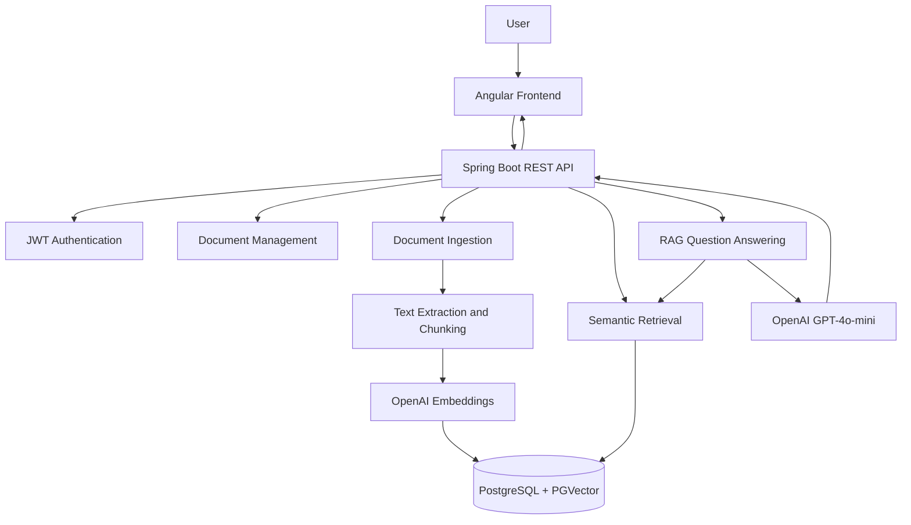

# DocuMind — AI-Powered Document Intelligence

DocuMind is an AI-powered document intelligence platform that enables users to upload documents, perform semantic searches, and ask natural-language questions about their documents using Retrieval-Augmented Generation (RAG).

Built with Angular, Spring Boot, PostgreSQL and PGVector, the application combines modern web development with AI-powered document processing and contextual information retrieval.

## ✨ Key Features

- **User Authentication:** Secure user registration and login using JWT-based authentication.
- **Document Management:** Upload, view, search, and download documents.
- **Document Ingestion:** Extract document text, divide content into chunks, and generate vector embeddings.
- **Semantic Search:** Retrieve relevant document content using vector similarity search.
- **AI-Powered Q&A:** Ask natural-language questions and receive context-aware answers using Retrieval-Augmented Generation (RAG).
- **User Data Isolation:** Ensure document access and retrieval are restricted to the authenticated user.
- **Responsive Interface:** Angular-based frontend with dedicated authentication and document dashboard views.

## 🛠️ Technology Stack

| Category | Technologies |
|---|---|
| Frontend | Angular 22, TypeScript, HTML5, SCSS |
| Backend | Java 21, Spring Boot 4 |
| AI Integration | Spring AI, OpenAI API |
| Chat Model | GPT-4o-mini |
| Embedding Model | text-embedding-3-small |
| Database | PostgreSQL 18 |
| Vector Search | PGVector |
| Authentication | JWT |
| Containerization | Docker, Docker Compose |
| Web Server | Nginx |
| Testing | Vitest |

## 🏗️ System Architecture

The application follows a frontend-backend architecture in which Angular communicates with Spring Boot through REST APIs. The backend manages authentication, document processing, vector storage, semantic retrieval, and AI-powered question answering.



## 🔄 Document Processing Workflow

1. **Document Upload:** The user uploads a document through the Angular frontend.
2. **Text Extraction:** The backend extracts textual content from the uploaded document.
3. **Chunking:** Extracted text is divided into smaller, manageable chunks.
4. **Embedding Generation:** Spring AI integrates with OpenAI to generate vector embeddings.
5. **Vector Storage:** Embeddings and associated document metadata are stored in PostgreSQL using PGVector.
6. **Semantic Retrieval:** When a user submits a question, the backend searches for semantically relevant document chunks.
7. **Answer Generation:** Retrieved context is provided to GPT-4o-mini to generate a context-aware response.

## 📁 Project Structure

```text
doc-intelligence/
│
├── src/
│   └── app/
│       ├── auth/
│       │   ├── login.html
│       │   ├── login.scss
│       │   ├── login.ts
│       │   ├── register.html
│       │   ├── register.scss
│       │   └── register.ts
│       │
│       ├── dashboard/
│       │   ├── dashboard.html
│       │   ├── dashboard.scss
│       │   └── dashboard.ts
│       │
│       ├── services/
│       │   ├── api.ts
│       │   ├── auth.ts
│       │   ├── auth.guard.ts
│       │   ├── auth.interceptor.ts
│       │   └── guest.guard.ts
│       │
│       ├── app.config.ts
│       ├── app.routes.ts
│       ├── app.ts
│       └── document.model.ts
│
├── Dockerfile
├── nginx.conf
├── .dockerignore
├── angular.json
├── package.json
└── README.md
```

## 🚀 Getting Started

### Prerequisites

Ensure the following tools are installed:

- Node.js 22 or compatible version
- npm
- Git
- A running DocuMind backend

For containerized execution, Docker is also required.

### 1. Clone the Repository

```bash
git clone https://github.com/Faizan-11/doc-intelligence.git

cd doc-intelligence
```

### 2. Install Dependencies

Install the project dependencies using the lockfile:

```bash
npm ci
```

### 3. Start the Development Server

```bash
npm start
```

Alternatively, use Angular CLI directly:

```bash
ng serve
```

Once the development server is running, open:

```text
http://localhost:4200
```

The application automatically reloads when source files are modified.

**Backend Requirement:** The frontend communicates with the DocuMind backend at `http://localhost:8080`. Ensure that the backend and its database are running before using authentication and document-related functionality.

Refer to the [DocuMind Backend Repository](https://github.com/Faizan-11/doc-intelligence-api) for backend setup instructions.

## 🐳 Docker Deployment

The frontend uses a multi-stage Docker build to create an optimized Angular production build and serve it through Nginx.

### 1. Build the Docker Image

From the frontend project directory, run:

```bash
docker build -t documind-frontend .
```

### 2. Run the Container

```bash
docker run -d \
  --name documind-frontend \
  --restart unless-stopped \
  -p 4200:80 \
  documind-frontend
```

### 3. Access the Application

Open:

```text
http://localhost:4200
```

### 4. Stop the Container

```bash
docker stop documind-frontend
```

### 5. Remove the Container

```bash
docker rm documind-frontend
```

**Note:** The frontend's current API configuration points to `http://localhost:8080`. The backend must be accessible at that address for the complete application workflow to function.

## 🧪 Testing

The project uses Vitest as its unit testing framework.

Run the unit test suite:

```bash
npm test
```

### Production Build

To generate an optimized production build:

```bash
npm run build
```

The generated build artifacts are stored in the `dist/` directory.

## 🔗 Related Repository

**Backend — DocuMind API**

[https://github.com/Faizan-11/doc-intelligence-api](https://github.com/Faizan-11/doc-intelligence-api)

The backend repository contains the Spring Boot REST API, authentication, document processing, vector database integration, and RAG implementation.

## 👨‍💻 Author

Developed as a full-stack AI application demonstrating modern frontend engineering, backend development, vector databases, and Retrieval-Augmented Generation.

**GitHub:** [Faizan-11](https://github.com/Faizan-11)